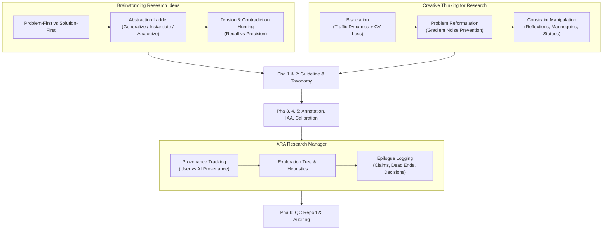
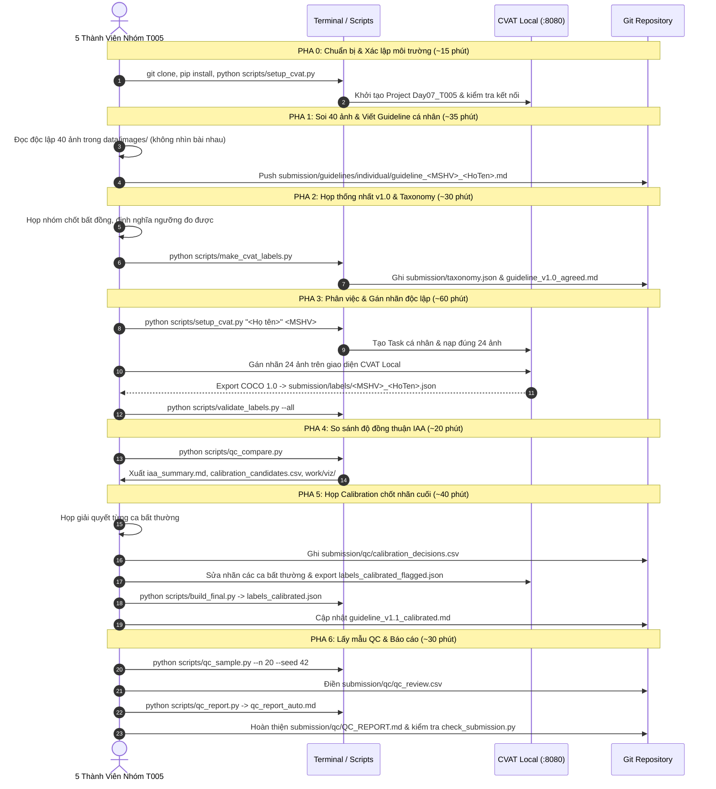

# BẢN PHÂN TÍCH HỆ THỐNG VÀ KẾ HOẠCH HÀNH ĐỘNG CHI TIẾT LAB 07
## Đề tài: Guideline, Taxonomy & Quality Control (QC) cho Dữ liệu Thị giác Máy tính
**Nhóm thực hiện:** Nhóm T005 (5 thành viên · 40 ảnh · K = 3 người gán/ảnh · CVAT Local)

---

## MỤC LỤC
1. [Phân Tích Chi Tiết Kiến Trúc Folder Hệ Thống](#1-phân-tích-chi-tiết-kiến-trúc-folder-hệ-thống)
2. [Tích Hợp Ba Phương Pháp Luận Nghiên Cứu Chuyên Sâu](#2-tích-hợp-ba-phương-pháp-luận-nghiên-cứu-chuyên-sâu)
   - 2.1. Creative Thinking for Research (`creative-thinking-for-research`)
   - 2.2. Brainstorming Research Ideas (`brainstorming-research-ideas`)
   - 2.3. Live Research Project Management & Provenance (`ara-research-manager`)
3. [Kế Hoạch Thực Hiện Chi Tiết Từng Bước (Pha 0 Đến Pha 6 & Epilogue)](#3-kế-hoạch-thực-hiện-chi-tiết-từng-bước)
4. [Bảng Phân Công & Chỉ Số Đầu Ra (Deliverables Matrix)](#4-bảng-phân-công--chỉ-số-đầu-ra)
5. [Cây Quyết Định QC & Quản Trị Rủi Ro Chấm Điểm (Rubric Alignment)](#5-cây-quyết-định-qc--quản-trị-rủi-ro-chấm-điểm)

---

## 1. PHÂN TÍCH CHI TIẾT KIẾN TRÚC FOLDER HỆ THỐNG

Dự án được cấu trúc theo mô hình **Chu trình Kỹ thuật Dữ liệu Khép kín (Closed-loop Data Annotation Engineering)**, bao gồm đặc tả taxonomy, quy chuẩn guideline, pipeline tự động chia việc, thuật toán đo độ đồng thuận liên gán nhãn (IAA), quy trình hiệu chuẩn (calibration) và kiểm định chất lượng (QC).

```text
K5-L23-Day07-T005-Guideline-Taxonomy-QC/
├── data/                               # Dữ liệu ảnh gốc & nguồn gốc
│   ├── images/                         # 40 ảnh cảnh đường phố châu Á (img_001.jpg -> img_040.jpg)
│   ├── ATTRIBUTION.csv                 # Metadata, nguồn gốc ảnh (giữ nguyên bản quyền)
│   └── README.md                       # Mô tả đặc tính tập dữ liệu
├── guideline/                          # Bản thảo quy chuẩn gán nhãn khởi đầu
│   ├── guideline_v0_starter.md         # Bản sơ sài do GV cung cấp (cố ý thiếu ca khó)
│   └── TEMPLATE_guideline.md           # Khung mẫu chuẩn gồm 5 phần bắt buộc
├── cvat/                               # Cấu hình nạp vào công cụ CVAT
│   └── labels_generated.json           # File cấu hình nhãn sinh từ taxonomy.json
├── docs/                               # Tài liệu hướng dẫn & biểu mẫu
│   ├── CVAT_SETUP.md                   # Hướng dẫn thao tác thủ công trên giao diện CVAT
│   ├── QC_CHEATSHEET.md                # Tóm tắt công thức, định nghĩa lỗi và các ngưỡng QC
│   ├── QC_REPORT_TEMPLATE.md           # Template báo cáo QC cuối cùng
│   ├── INDIVIDUAL_NOTE_TEMPLATE.md     # Template ghi chú suy ngẫm cá nhân
│   └── assets/                         # Ảnh minh họa sample grid
├── scripts/                            # Bộ công cụ tự động hóa & thuật toán toán học
│   ├── common.py                       # Core module: Parser COCO, thuật toán IoU, Hungarian matching
│   ├── split_assign.py                 # Thuật toán phân bổ ảnh cân bằng tải, bảo đảm K người/ảnh
│   ├── setup_cvat.py                   # Script on-demand: Tạo Task trên CVAT Local theo Họ tên + MSSV
│   ├── create_cvat_task.py             # Client SDK giao tiếp CVAT REST API / SDK
│   ├── make_cvat_labels.py             # Biên dịch taxonomy.json sang định dạng JSON của CVAT
│   ├── validate_labels.py              # Bộ kiểm tra cú pháp, bounds, thuộc tính file JSON
│   ├── qc_compare.py                   # Đo IAA: Tính IoU trung bình, % đồng thuận lớp, phát hiện lệch
│   ├── viz_disagreement.py             # Trực quan hóa hộp vẽ đè nhau giữa các người gán
│   ├── prepare_calibration.py          # Trích xuất các ca bất thường cần họp hiệu chuẩn
│   ├── build_final.py                  # Hợp nhất nhãn sau hiệu chuẩn thành tập nhãn vàng (gold standard)
│   ├── qc_sample.py                    # Thuật toán lấy mẫu kiểm định (mọi ca khó + ngẫu nhiên n ảnh)
│   ├── qc_report.py                    # Phân tích thống kê tỉ lệ lỗi, gợi ý Hold/Rework/Release
│   ├── check_submission.py             # Script tự chấm kiểm tra độ toàn vẹn của repo trước khi nộp
│   └── drawing.py                      # Tiện ích vẽ bounding box và nhãn lên ảnh
├── submission/                         # KHÔNG GIAN BÀI NỘP CỦA NHÓM (Bắt buộc)
│   ├── taxonomy.json                   # Định nghĩa các lớp, thuộc tính và ngưỡng hệ thống
│   ├── guidelines/
│   │   ├── individual/                 # 5 file guideline cá nhân: guideline_<MSHV>_<HoTen>.md
│   │   ├── guideline_v1.0_agreed.md    # Guideline thống nhất cả nhóm sau khi họp Pha 2
│   │   └── guideline_v1.1_calibrated.md# Guideline cập nhật quy tắc mới sau khi họp Calibration
│   ├── labels/                         # 5 file nhãn cá nhân xuất từ CVAT: <MSHV>_<HoTen>.json
│   ├── individual_notes/               # 5 file bài học kinh nghiệm: <MSHV>_<HoTen>.md
│   └── qc/                             # Bằng chứng kiểm định chất lượng
│       ├── assignment.csv              # Bảng phân bổ 40 ảnh cho 5 người
│       ├── assignments/                # 5 file text danh sách ảnh của từng người (<MSHV>.txt)
│       ├── iaa_summary.md / .json      # Báo cáo độ đồng thuận liên gán nhãn
│       ├── calibration_candidates.csv  # Danh sách các ca bất thường do thuật toán phát hiện
│       ├── calibration_decisions.csv   # Quyết định đồng thuận của nhóm cho từng ca cờ
│       ├── labels_calibrated.json/.csv # Bộ nhãn đồng thuận cuối cùng của nhóm
│       ├── qc_sample.csv / qc_review.csv# Mẫu kiểm định và phiếu chấm lỗi thực tế
│       ├── qc_report_auto.md           # Thống kê tự động từ script
│       └── QC_REPORT.md                # Báo cáo kiểm định chất lượng chính thức của nhóm
├── work/                               # Thư mục tạm (Không commit lên Git)
│   ├── <MSHV>/images/                  # Ảnh phân phối riêng cho từng bạn (24 ảnh/người)
│   ├── viz/                            # Ảnh trực quan hóa ca bất thường
│   ├── calib/                          # Dữ liệu phục vụ phiên calibration
│   └── review/                         # Ảnh gắn ID đối tượng phục vụ bước QC cuối
├── CHECKPOINTS.md                      # Mốc thời gian và câu hỏi cốt lõi từng pha
├── GUIDE.md                            # Hướng dẫn chi tiết từng pha làm bài
├── RUBRIC.md                           # Thang chấm 100 điểm của giảng viên
├── RULES.md                            # Quy tắc trung thực học thuật & ràng buộc làm bài
├── SUBMISSION.md                       # Quy chuẩn nộp repo và danh mục tệp
├── TEAM.md                             # Danh sách thành viên, phân công & kết quả tóm tắt
└── README.md                           # Tiêu đề nhóm và tổng quan đồ án
```

---

## 2. TÍCH HỢP BA PHƯƠNG PHÁP LUẬN NGHIÊN CỨU CHUYÊN SÂU

Để đạt điểm tối đa (100/100 theo `RUBRIC.md`) và biến bài lab thành một công trình nghiên cứu chuẩn mực, chúng ta áp dụng 3 kỹ năng nghiên cứu chuyên sâu:



### 2.1. Creative Thinking for Research (`creative-thinking-for-research`)
* **Bisociation (Tư duy kết hợp đa lĩnh vực):**
  * Kết hợp **Vật lý động học giao thông** (Kích thước thực, khả năng gây tai nạn) với **Hàm mất mát thị giác máy tính** (IoU Loss, Bounding Box Regression).
  * *Ứng dụng:* Thay vì gán một xe máy có người ngồi lái thành 2 box chồng chéo không rõ ranh giới, ta phân tích động học: Người lái xe máy gắn liền với phương tiện thành một khối chuyển động $\rightarrow$ Định nghĩa ranh giới gán `motorcycle` và `person` có quy tắc loại trừ hoặc bao hàm rõ ràng.
* **Problem Reformulation (Tái định hình bài toán):**
  * *Chuyển dịch nhận thức:* Từ *"Làm sao để vẽ thật nhiều box trên ảnh?"* thành *"Làm sao để loại bỏ nhiễu độc hại (toxic gradients) đối với mô hình nhận diện?"*.
  * *Hệ quả:* Những vật thể giả tạo (xe in trên biển quảng cáo, hình phản chiếu qua gương kính tòa nhà, ma-nơ-canh mặc quần áo) **tuyệt đối không được gán** là vật thể thật, vì nếu dạy mô hình nhận diện xe trên biển quảng cáo, xe tự lái sẽ phanh gấp giữa đường (False Positive cực kỳ nguy hiểm).
* **Constraint Manipulation (Thao túng ràng buộc):**
  * Ràng buộc kích thước: Đề bài quy định vật cao $< 20\text{ px}$ không gán riêng mà gom vào `ignore_region`. Ta biến ràng buộc này thành cơ chế bảo vệ độ chính xác: tránh việc các annotator tranh cãi về các đốm mờ ở chân trời.

### 2.2. Brainstorming Research Ideas (`brainstorming-research-ideas`)
* **Problem-First Thinking:**
  * Xuất phát từ nỗi đau: Guideline v0 chỉ có 5 dòng định nghĩa sơ sài, dẫn đến việc 2 người cùng nhìn 1 chiếc xe tuk-tuk sẽ gán thành 2 lớp khác nhau (`car` vs `truck` vs `motorcycle`) $\rightarrow$ Đo IAA sẽ rớt thảm hại dưới ngưỡng 95%.
* **The Abstraction Ladder (Nấc thang trừu tượng):**
  * **Đi lên (Generalize):** Xây dựng nguyên tắc phân loại theo công năng (Chở người vs Chở hàng) thay vì hình dáng bên ngoài.
  * **Đi xuống (Instantiate):** Soi trực tiếp từng ca kỳ dị trong 40 ảnh: Xe lam/xe lôi ba bánh trong `img_003.jpg`, người đẩy xe hàng trong `img_015.jpg`, xe bán tải chở tượng trong `img_022.jpg`.
  * **Đi ngang (Analogize):** Kế thừa quy tắc phân loại từ các tập dữ liệu tự hành chuẩn quốc tế như **Waymo Open Dataset, nuScenes, Cityscapes**.
* **Tension and Contradiction Hunting (Giải quyết mâu thuẫn):**
  * *Mâu thuẫn 1: Chi tiết vs Tốc độ:* Gán tỉ mỉ từng người trong chợ đông đúc $\leftrightarrow$ Hết thời gian làm lab $\rightarrow$ Giải pháp: Áp dụng `ignore_region` cho các đám đông có mật độ $\ge 5$ người chen chúc nhau mà thân người bị che $> 80\%$.
  * *Mâu thuẫn 2: Nhất quán vs Đầy đủ:* Cố gán các phần bị khuất hoàn toàn $\leftrightarrow$ Độ lệch IoU giữa các người gán tăng vọt $\rightarrow$ Giải pháp: Quy định box **chỉ ôm sát phần nhìn thấy (visible part)**, không đoán phần khuất vô hình.

### 2.3. Live Research Project Management (`ara-research-manager`)
* **Truy xuất nguồn gốc (Provenance Tracking):**
  * Mọi quyết định thêm vào guideline đều phải có nhãn nguồn gốc: `[user]` (do thành viên phát hiện và chốt), `[ai-suggested]` (do AI gợi ý phân tích), `[user-revised]` (thành viên hiệu chỉnh lại).
* **Cây thám hiểm & Quyết định (Exploration Tree & Heuristics):**
  * Ghi lại lịch sử: Tại sao nhóm từng định gán tuk-tuk là `car`, nhưng sau đó từ bỏ (dead-end) và chuyển sang quy ước `ignore_region` hoặc `van`? Ghi lại toàn bộ hành trình thử nghiệm này vào hồ sơ nghiên cứu.

---

## 3. KẾ HOẠCH THỰC HIỆN CHI TIẾT TỪNG BƯỚC

Quy trình chuẩn hóa 240 phút (4 giờ) chia làm 7 giai đoạn thực hiện độc lập và phối hợp nhịp nhàng:



---

### PHA 0: Chuẩn Bị & Khởi Tạo Môi Trường (15 phút · CP0)

* **Mục tiêu:** Đảm bảo toàn bộ 5 thành viên sẵn sàng môi trường, repo Git đồng bộ và CVAT Local hoạt động trơn tru.
* **Các bước thực hiện:**
  1. Kiểm tra Git user configuration:
     ```bash
     git config user.name "Họ và tên của bạn"
     git config user.email "email_cua_ban@domain.com"
     ```
  2. Cài đặt các thư viện phụ thuộc:
     ```bash
     pip install -r requirements.txt
     ```
  3. Kiểm tra máy chủ CVAT Local đang chạy tại `http://localhost:8080`.
  4. Đã điền sẵn thông tin 5 thành viên vào [TEAM.md](file:///c:/Users/basduy05/Downloads/VINAI/lab/lab-day7/K5-L23-Day07-T005-Guideline-Taxonomy-QC/TEAM.md) và tiêu đề [README.md](file:///c:/Users/basduy05/Downloads/VINAI/lab/lab-day7/K5-L23-Day07-T005-Guideline-Taxonomy-QC/README.md).

---

### PHA 1: Khám Phá 40 Ảnh & Soạn Thảo Guideline Cá Nhân (35 phút · CP1)

* **Mục tiêu:** Từng thành viên làm việc **hoàn toàn độc lập** (không trao đổi, không xem bài của nhau), soi kỹ 40 ảnh trong `data/images/` để nhận diện các thiếu sót chí mạng của Guideline v0.
* **Phương pháp tư duy (Cognitive Lenses):**
  * *Problem-First:* Soi từng ảnh và tự hỏi: "Nếu áp dụng v0 vào ảnh `img_007.jpg`, người khác sẽ gán là gì? Ranh giới box ở đâu?".
  * *Tension Hunting:* Phát hiện mâu thuẫn giữa việc phân biệt xe chở hàng cồng kềnh với xe thùng kín (`truck` vs `van`).
* **Nhiệm vụ cụ thể của mỗi người:**
  * Copy [guideline/TEMPLATE_guideline.md](file:///c:/Users/basduy05/Downloads/VINAI/lab/lab-day7/K5-L23-Day07-T005-Guideline-Taxonomy-QC/guideline/TEMPLATE_guideline.md) thành:
    `submission/guidelines/individual/guideline_<MSHV>_<HoTen>.md`
  * Viết đủ 5 phần:
    1. **Mục tiêu:** Đối tượng phục vụ (mô hình xe tự lái / camera giám sát giao thông), rủi ro an toàn nếu sai sót.
    2. **Định nghĩa lớp:** Bổ sung ví dụ và **phản ví dụ** cho 6 lớp (`car`, `truck`, `van`, `motorcycle`, `person`, `ignore_region`).
    3. **Thuộc tính với ngưỡng đo lường cụ thể:**
       * `occluded_level`:
         * Mức `0`: Nhìn thấy rõ $\ge 90\%$ diện tích thân xe/người.
         * Mức `1`: Bị che khuất từ $10\%$ đến $35\%$ diện tích.
         * Mức `2`: Bị che khuất từ $35\%$ đến $70\%$ diện tích.
         * Mức `3`: Bị che khuất trên $70\%$ (vẫn nhận diện được nhờ ngữ cảnh).
       * `truncated`: `yes` nếu mép bounding box chạm biên ảnh $> 5\text{ px}$, ngược lại là `no`.
       * `can_review`: `true` khi gặp tình huống mơ hồ mà quy tắc chưa định nghĩa.
    4. **Quy tắc vẽ box:** Box ôm sát phần nhìn thấy, xử lý vật phản chiếu qua gương, hình in trên áo/xe (không gán).
    5. **Bảng phân tích ca khó:** Nêu tối thiểu 3 ca khó thực tế có chỉ đích danh tên ảnh (ví dụ: `img_003.jpg`, `img_018.jpg`, `img_032.jpg`).
* **Sản phẩm:** 5 commit mang tên 5 thành viên đưa 5 file cá nhân lên nhánh Git.

---

### PHA 2: Họp Nhóm, Thống Nhất Guideline v1.0 & Taxonomy (30 phút · CP2)

* **Mục tiêu:** Họp toàn thể 5 người, đối chiếu 5 bản guideline cá nhân, tranh luận và giải quyết triệt để mọi bất đồng để tạo ra một "bộ luật" thống nhất duy nhất.
* **Các nội dung tranh luận then chốt:**
  * **Xe tuk-tuk / xe 3 bánh / xe lôi:** Gán là `car`, `motorcycle`, hay gom vào `ignore_region`? *(Khuyến nghị: Nếu có buồng lái gắn liền thùng xe chở khách $\rightarrow$ `car` hoặc đưa vào quy tắc ngoại lệ rõ ràng)*.
  * **Người lái xe máy:** Gán 1 box gộp hay 2 box riêng? *(Quy tắc chuẩn: Gán 1 box `person` cho người lái ôm từ đỉnh đầu đến chân, và 1 box `motorcycle` ôm toàn bộ xe bao gồm cả bánh xe)*.
  * **Vật chở sau xe:** Hàng hóa nhô cao trên thùng xe tải có tính vào box xe không? *(Quy định: Hàng rời cồng kềnh vượt quá kích thước thùng xe $\rightarrow$ box chỉ ôm sát thân xe cơ học, không bao trọn bó củi/tấm tôn thừa)*.
  * **Vật không phải vật thật:** Tượng xe, ma-nơ-canh, ảnh chụp xe dán trên biển quảng cáo $\rightarrow$ **Không gán box** để tránh mô hình học sai.
* **Các bước thực thi kỹ thuật:**
  1. Soạn thảo văn bản đồng thuận nhóm: `submission/guidelines/guideline_v1.0_agreed.md`.
  2. Đồng bộ hóa file [submission/taxonomy.json](file:///c:/Users/basduy05/Downloads/VINAI/lab/lab-day7/K5-L23-Day07-T005-Guideline-Taxonomy-QC/submission/taxonomy.json) khớp 100% với guideline v1.0. **Tuyệt đối không sửa mục `"rules"`** trong file này.
  3. Biên dịch cấu hình nhãn CVAT:
     ```bash
     python scripts/make_cvat_labels.py
     ```
     *(Lệnh này sinh ra file `cvat/labels_generated.json` chuẩn).*
* **Sản phẩm:** `guideline_v1.0_agreed.md`, `taxonomy.json`, `cvat/labels_generated.json`.

---

### PHA 3: Phân Chia Ảnh & Gán Nhãn Độc Lập Trên CVAT Local (60 phút · CP3)

* **Mục tiêu:** Mỗi bạn nhận đúng 24 ảnh của mình, gán nhãn độc lập trên CVAT Local, xuất file JSON chuẩn COCO 1.0.
* **Quy trình phân việc On-Demand:**
  Mỗi thành viên mở terminal chạy đúng câu lệnh của mình:
  ```bash
  # Thành viên nào chạy lệnh thì hệ thống mới tạo Task cho bạn đó:
  python scripts/setup_cvat.py "NGUYỄN ĐỨC CƯỜNG" 2A202603040
  python scripts/setup_cvat.py "HOÀNG NHẬT ANH" 2A202603183
  python scripts/setup_cvat.py "NGUYỄN BÁ DUY" 2A202603192
  python scripts/setup_cvat.py "ĐỖ HUY KIÊN" 2A202603216
  python scripts/setup_cvat.py "PHẠM MẠNH HÙNG" 2A202603240
  ```
* **Thao tác gán nhãn trên CVAT Local:**
  1. Truy cập vào link Task được cấp (ví dụ: `http://localhost:8080/tasks/29`).
  2. Nhấn phím tắt `N` để vẽ Rectangle.
  3. Chọn đúng lớp và điền thuộc tính: `occluded_level`, `truncated`, `can_review`.
  4. Bấm `Ctrl + S` để lưu nhãn thường xuyên.
  5. **Nguyên tắc vàng:** Tuyệt đối không xem nhãn của nhau trong suốt quá trình gán nhãn.
* **Export dữ liệu:**
  1. Menu **Actions** $\rightarrow$ **Export task dataset** $\rightarrow$ Chọn **COCO 1.0**.
  2. **Tắt (bỏ chọn)** ô `Save images`.
  3. Tải file zip, giải nén lấy `instances_default.json`, đổi tên và đặt vào `submission/labels/`:
     * `2A202603040_NguyenDucCuong.json`
     * `2A202603183_HoangNhatAnh.json`
     * `2A202603192_NguyenBaDuy.json`
     * `2A202603216_DoHuyKien.json`
     * `2A202603240_PhamManhHung.json`
* **Kiểm tra tự động trước khi nộp:**
  ```bash
  python scripts/validate_labels.py --all
  ```
  *Bắt buộc phải đạt 0 ERROR.*

---

### PHA 4: So Sánh Dữ Liệu & Đo Độ Đồng Thuận IAA (20 phút · CP4)

* **Mục tiêu:** Dùng các thuật toán ghép cặp (Hungarian Matching) và đo lường khoảng cách hình học để đánh giá mức độ hiểu thống nhất của nhóm đối với guideline v1.0.
* **Câu lệnh thực thi:**
  ```bash
  python scripts/qc_compare.py
  ```
* **Thuật toán đánh giá của script:**
  * Ghép box 1-1 theo IoU giảm dần giữa từng cặp người gán cùng 1 ảnh (ngưỡng `match_iou = 0.5`).
  * Đo **IoU trung bình** trên các cặp ghép được: Yêu cầu $\ge 0.85$.
  * Đo **Tỉ lệ đồng thuận lớp (% cùng lớp)**: Yêu cầu $\ge 95\%$.
  * Phát hiện các lỗi bất thường:
    * `bo_sot_thua`: Người A có box nhưng người B bỏ sót.
    * `sai_lop`: Cùng 1 vật nhưng người gán `car`, người gán `van`.
    * `iou_thap`: Box lệch nhau (IoU < ngưỡng quy định).
    * `sai_thuoc_tinh`: Lệch mức `occluded_level`.
* **Phân tích ca lệch bằng hình ảnh:**
  ```bash
  python scripts/viz_disagreement.py --images flagged
  ```
  *Mở thư mục `work/viz/` để xem ảnh trực quan: box của từng người được in bằng các màu khác nhau để thấy rõ độ lệch.*
* **Sản phẩm:** `submission/qc/iaa_summary.md`, `submission/qc/calibration_candidates.csv`, `submission/qc/flagged_images.txt`.

---

### PHA 5: Họp Hiệu Chuẩn (Calibration) & Chốt Nhãn Cuối v1.1 (40 phút · CP5)

* **Mục tiêu:** Cả 5 người họp lại, mở từng ca trong `calibration_candidates.csv` và ảnh trong `work/viz/` để quyết định sự thật chân lý (Ground Truth).
* **Quy tắc ghi nhận quyết định:**
  * Mở file `submission/qc/calibration_decisions.csv` (sinh mẫu từ `build_final.py`).
  * **Mỗi quyết định ghi đúng một dòng**: Cột `case_id`, `image`, `quyet_dinh`, `quy_tac_ghi_vao_guideline`, `phien_ban_guideline` (v1.1), `nguoi_chot`.
  * Mọi ảnh bị cờ (flagged) bắt buộc phải có ít nhất một dòng quyết định.
* **Cập nhật nhãn và guideline:**
  1. Đóng gói ca hiệu chuẩn:
     ```bash
     python scripts/prepare_calibration.py
     ```
  2. Tạo Task calibration trên CVAT Local từ các ảnh trong `work/calib/images/`, import `work/calib/consensus_flagged.json` để sửa các box theo đúng quyết định của nhóm.
  3. Export nhãn đã sửa ra `submission/qc/labels_calibrated_flagged.json`.
  4. Biên soạn phiên bản guideline cập nhật: `submission/guidelines/guideline_v1.1_calibrated.md` ghi nhận các luật mới được bổ sung.
  5. Chạy lệnh sinh tập nhãn đồng thuận cuối cùng:
     ```bash
     python scripts/build_final.py
     ```
     *(Đầu ra: `submission/qc/labels_calibrated.json` và `submission/qc/labels_calibrated.csv`).*

---

### PHA 6: Lấy Mẫu Kiểm Định QC & Biên Soạn Báo Cáo Cuối Cùng (30 phút · CP6)

* **Mục tiêu:** Kiểm toán độc lập trên tập dữ liệu đã qua hiệu chuẩn, tính toán tỉ lệ lỗi khách quan và đưa ra phán quyết: **Release (Phát hành)**, **Hold (Tạm giữ)**, hay **Rework (Làm lại)**.
* **Quy trình thực hiện:**
  1. **Lấy mẫu QC:**
     ```bash
     python scripts/qc_sample.py --n 20 --seed 42
     ```
     *(Script tự động chọn toàn bộ các ảnh từng bị cờ + thêm 20 ảnh ngẫu nhiên, sinh ra `submission/qc/qc_sample.csv` và ảnh hiển thị ID trong `work/review/`).*
  2. **Chấm phiếu QC (`submission/qc/qc_review.csv`):**
     * Mở từng ảnh trong `work/review/`.
     * Đối chiếu từng vật xem có lỗi không:
       * Không lỗi: điền `error_type = khong`.
       * Có lỗi: điền một trong các mã: `bo_sot`, `thua`, `sai_lop`, `sai_vi_tri_kich_thuoc`, `sai_thuoc_tinh`.
  3. **Chạy script thống kê tỉ lệ lỗi:**
     ```bash
     python scripts/qc_report.py
     ```
     *(Đầu ra: `submission/qc/qc_report_auto.md`).*
  4. **Viết Báo cáo QC chính thức (`submission/qc/QC_REPORT.md`):**
     * Dựa trên template [docs/QC_REPORT_TEMPLATE.md](file:///c:/Users/basduy05/Downloads/VINAI/lab/lab-day7/K5-L23-Day07-T005-Guideline-Taxonomy-QC/docs/QC_REPORT_TEMPLATE.md), hoàn thiện đủ 7 mục.
     * **Bắt buộc ghi rõ mẫu số** khi báo cáo tỉ lệ lỗi:
       * Tỉ lệ lỗi theo đối tượng = $\frac{\text{Số đối tượng lỗi}}{\text{Tổng đối tượng trong mẫu}}$.
       * Tỉ lệ lỗi theo ảnh = $\frac{\text{Số ảnh có lỗi}}{\text{Tổng số ảnh trong mẫu}}$ (Ngưỡng Release: $\le 2\%$).
     * Đi theo cây quyết định: Hold $\rightarrow$ Rework $\rightarrow$ Release.
  5. **Viết ghi chú cá nhân:** Mỗi bạn hoàn thành file `submission/individual_notes/<MSHV>_<HoTen>.md` nêu rõ bài học kinh nghiệm và các ca mình đã gán sai.
  6. **Chạy script kiểm tra bài nộp toàn diện:**
     ```bash
     python scripts/check_submission.py
     ```
     *Mục tiêu: Đạt kết quả **0 LỖI**.*

---

### PHA EPILOGUE: Thiết Lập Hồ Sơ Khoa Học Chuyên Sâu (`ara-research-manager`)

Sau khi hoàn thành toàn bộ bài nộp kỹ thuật, ta kích hoạt phương pháp luận của `ara-research-manager` để đúc kết hồ sơ lưu vết (provenance):
* Tạo thư mục `ara/`:
  * `ara/trace/exploration_tree.yaml`: Ghi nhận cây quyết định phân loại phương tiện, các ngõ cụt (dead-ends) khi phân biệt xe ba bánh và xe tải nhỏ.
  * `ara/logic/claims.md`: Khẳng định các phát hiện: *"Mức phạt IoU 0.85 là phù hợp với xe lớn $\ge 50\text{ px}$, nhưng gây sai số giả tạo trên xe máy $< 30\text{ px}$"*.
  * `ara/logic/solution/heuristics.md`: Ghi chép các thủ thuật: cách chia vùng `ignore_region` cho khu vực bóng cây phản chiếu, cách dùng `can_review` để lọc ca mơ hồ.

---

## 4. BẢNG PHÂN CÔNG & CHỈ SỐ ĐẦU RA

| Thành viên | MSHV | Vai trò phụ trách chính trong nhóm | Sản phẩm cá nhân bắt buộc |
|:---|:---:|:---|:---|
| **NGUYỄN BÁ DUY** | `2A202603192` | Nhóm trưởng · Quản lý Git & CVAT Server · Điều phối phân việc | `guideline_2A202603192_NguyenBaDuy.md`<br/>`2A202603192_NguyenBaDuy.json`<br/>`2A202603192_NguyenBaDuy.md` |
| **HOÀNG NHẬT ANH** | `2A202603183` | Trưởng ban Quy chuẩn · Soạn thảo Guideline v1.0 & v1.1 | `guideline_2A202603183_HoangNhatAnh.md`<br/>`2A202603183_HoangNhatAnh.json`<br/>`2A202603183_HoangNhatAnh.md` |
| **NGUYỄN ĐỨC CƯỜNG**| `2A202603040` | Chuyên viên Kỹ thuật Taxonomy · Quản lý taxonomy.json & nhãn | `guideline_2A202603040_NguyenDucCuong.md`<br/>`2A202603040_NguyenDucCuong.json`<br/>`2A202603040_NguyenDucCuong.md` |
| **ĐỖ HUY KIÊN** | `2A202603216` | Trưởng ban Đo lường IAA · Phân tích ma trận bất đồng | `guideline_2A202603216_DoHuyKien.md`<br/>`2A202603216_DoHuyKien.json`<br/>`2A202603216_DoHuyKien.md` |
| **PHẠM MẠNH HÙNG** | `2A202603240` | Kiểm toán trưởng QC · Giám sát phiếu qc_review & Báo cáo QC | `guideline_2A202603240_PhamManhHung.md`<br/>`2A202603240_PhamManhHung.json`<br/>`2A202603240_PhamManhHung.md` |

---

## 5. CÂY QUYẾT ĐỊNH QC & QUẢN TRỊ RỦI RO CHẤM ĐIỂM

### 5.1. Cây quyết định chuẩn mực: Hold $\rightarrow$ Rework $\rightarrow$ Release

```text
[Bắt đầu đánh giá đợt dữ liệu]
  │
  ├── 1. Guideline còn điểm mâu thuẫn? Dữ liệu ảnh bị lỗi hỏng?
  │       ├── CÓ  ──> Quyết định: [HOLD] (Tạm dừng gán nhãn, sửa triệt để guideline v1.1)
  │       └── KHÔNG
  │             │
  ├── 2. Tỉ lệ ảnh lỗi > 2%? HOẶC có 1 loại lỗi lặp đi lặp lại (>= 3 lỗi cùng kiểu)? HOẶC IAA < ngưỡng?
  │       ├── CÓ  ──> Quyết định: [REWORK] (Hiệu chuẩn lại quy tắc, gán lại các ảnh lỗi)
  │       └── KHÔNG
  │             │
  └── 3. Tỉ lệ ảnh lỗi <= 2% VÀ không có lỗi lặp lại VÀ IAA đạt chuẩn?
          └── CÓ  ──> Quyết định: [RELEASE] (Đủ điều kiện đóng gói phát hành tập dữ liệu)
```

> **Lưu ý tối quan trọng theo Rubric:** Báo cáo trung thực đưa ra quyết định **Rework** hoặc **Hold** (có phân tích nguyên nhân thỏa đáng) **vẫn được trọn vẹn điểm tối đa**. Việc cố tình làm giả số liệu để báo **Release** khi tỉ lệ lỗi $> 2\%$ sẽ bị trừ toàn bộ điểm mục QC!

### 5.2. Danh mục các lỗi bị trừ điểm nặng cần tuyệt đối tránh

1. **Sao chép Guideline:** Guideline cá nhân giống hệt bản v0 hoặc giống hệt nhau $\rightarrow$ Mất toàn bộ 15 điểm cá nhân.
2. **Sửa đổi mục `"rules"` trong `taxonomy.json`:** Tự tiện hạ ngưỡng IoU hoặc thay đổi kích thước tối thiểu $\rightarrow$ Mất điểm mục Taxonomy.
3. **Thiếu mẫu số:** Ghi tỉ lệ lỗi dạng "15%" thay vì "6/40 ảnh = 15%" $\rightarrow$ Bị trừ điểm mục Báo cáo QC.
4. **Không có commit mang tên mình:** Mỗi thành viên bắt buộc phải tự commit các file của mình từ máy cá nhân lên Git.
5. **Commit thư mục tạm:** Tuyệt đối không commit thư mục `work/` lên Git repository.
